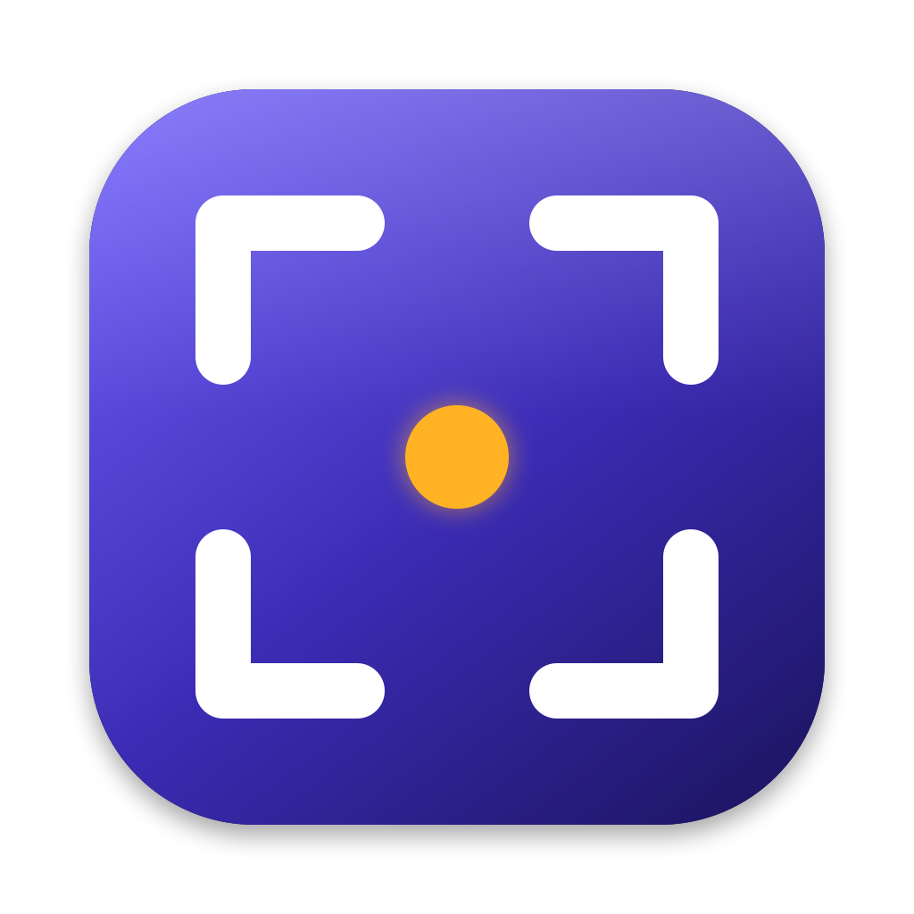

<p align="center"></p>

# Kadraj

**An open-source screenshot tool for macOS.** Installs with a single command — no admin rights, Homebrew or App Store needed, including on managed work Macs.

[Türkçe](README.md)

> ⚠️ Early development. Screen capture works; other features land according to the roadmap below.

## Install

```bash
# Latest release
curl -fsSL https://raw.githubusercontent.com/mahiruslu/kadraj/main/install.sh | bash

# A specific release (with or without the leading v)
curl -fsSL https://raw.githubusercontent.com/mahiruslu/kadraj/main/install.sh | bash -s -- 1.2.0

# Development branch (nightly build of main)
curl -fsSL https://raw.githubusercontent.com/mahiruslu/kadraj/main/install.sh | bash -s -- main
```

Requires macOS 14 Sonoma or later (Apple Silicon and Intel).

### Why no admin rights?

- Installs into `/Applications` when it is writable, otherwise into `~/Applications`. The script never asks for an administrator password.
- The app is signed with an Apple Developer ID and notarized by Apple, so Gatekeeper does not complain.
- The archive's SHA-256 checksum is verified; if verification fails, the existing install is left untouched.

### Permissions

Kadraj only needs **Screen Recording** permission. On first launch Kadraj guides you: enable Kadraj under *System Settings → Privacy & Security → Screen Recording*, then relaunch Kadraj.

macOS 15 and later occasionally show *"Kadraj is requesting to bypass the system private window picker…"* for apps that capture the screen directly. Every ScreenCaptureKit-based screenshot tool gets this system prompt; choose **Allow** to continue.

If your organization blocks this permission via MDM, IT can let standard users grant it themselves with the profile in [docs/MDM.md](docs/MDM.md).

### Uninstall

```bash
curl -fsSL https://raw.githubusercontent.com/mahiruslu/kadraj/main/uninstall.sh | bash
```

## Usage

Kadraj lives in the menu bar (viewfinder icon).

| Shortcut | Action |
|---|---|
| `⌥⇧A` | Select an area (drag; arrow keys nudge, ⌥+arrows resize, Space switches to window mode, Esc cancels) |
| `⌥⇧W` | Capture a window (shadow can be toggled in settings) |
| `⌥⇧F` | Capture the whole screen under the pointer |

After each capture a **Quick Access** thumbnail appears in the bottom-right corner: copy, save, reveal in Finder, or drag it anywhere. Captures are saved to `~/Pictures/Kadraj` and copied to the clipboard by default. Shortcuts, folder and format (PNG/JPEG) are configurable in **Settings**.

For automation (Raycast, Alfred, Shortcuts):

```bash
open "kadraj://capture/area"   # or window, fullscreen
```

## Roadmap

- [x] Menu bar app, permission onboarding, curl installer
- [x] Area / window / full-screen capture, Quick Access, settings
- [ ] OCR (offline, Turkish included) and QR reading
- [ ] Annotation editor (arrows, boxes, text, blur, numbered steps…)
- [ ] Pin to screen
- [ ] Scrolling capture
- [ ] Screen recording and GIF
- [ ] Color picker and ruler

## Building from source

Requires Swift 6 (Xcode 16+ or Command Line Tools). There is no `.xcodeproj`; everything builds with SwiftPM.

Open the package in Xcode to edit (`xed .`). To run, use `scripts/dev.sh`: it builds, bundles a `.app`, signs and relaunches. Xcode's Run button does not load Info.plist, so the URL scheme and permissions misbehave there.

```bash
swift test                        # unit tests
scripts/dev.sh                    # fast dev loop (dist-dev/Kadraj.app)
scripts/bundle.sh                 # dist/Kadraj.app (universal, ad-hoc signed)
open dist/Kadraj.app
/bin/bash Tests/install_test.sh   # installer tests
```

> If `swift build` fails with a manifest link error under Command Line Tools (`Undefined symbols … PackageDescription`), use Xcode's toolchain: `export DEVELOPER_DIR=/Applications/Xcode.app/Contents/Developer`.

## Releasing (maintainers)

Pushing a `v*` tag makes GitHub Actions build, sign, notarize and upload `Kadraj.zip` + `Kadraj.zip.sha256` to the release. Every push to `main` refreshes the `nightly` prerelease. Required secrets are listed in the [Turkish README](README.md#sürüm-yayınlama-bakımcılar-için); without them the app is ad-hoc signed and not notarized.

## License

[MIT](LICENSE) © 2026 Mahir Uslu
