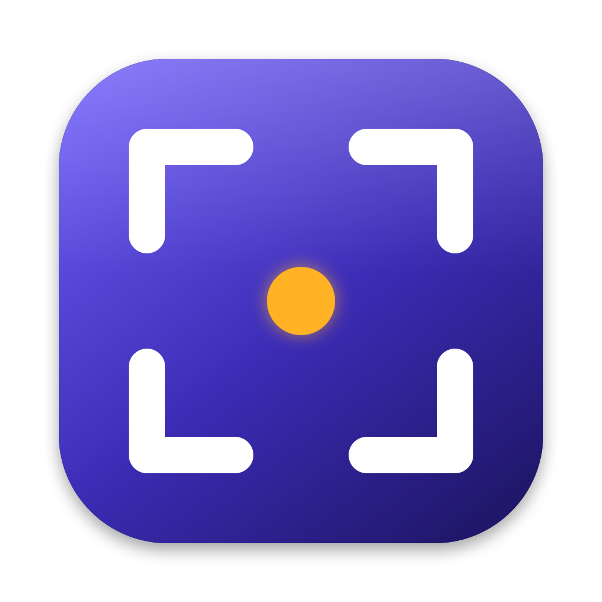

<p align="center"></p>

# Kadraj

**macOS için açık kaynak ekran görüntüsü aracı.** Admin yetkisi, Homebrew veya App Store gerektirmeden tek komutla kurulur — şirket bilgisayarları dahil.

[English](README.en.md)

> ⚠️ Erken geliştirme aşamasında. Ekran görüntüsü alma hazır; diğer özellikler aşağıdaki yol haritasına göre ekleniyor.

## Kurulum

```bash
# Son sürüm
curl -fsSL https://raw.githubusercontent.com/mahiruslu/kadraj/main/install.sh | bash

# Belirli bir sürüm (başında v olsa da olmasa da olur)
curl -fsSL https://raw.githubusercontent.com/mahiruslu/kadraj/main/install.sh | bash -s -- 1.2.0

# Geliştirme dalı (main'den derlenen nightly)
curl -fsSL https://raw.githubusercontent.com/mahiruslu/kadraj/main/install.sh | bash -s -- main
```

Gereksinim: macOS 14 Sonoma veya üstü (Apple Silicon ve Intel).

### Neden admin yetkisi gerekmiyor?

- `/Applications`'a yazabiliyorsanız oraya, yazamıyorsanız `~/Applications`'a kurulur. Script hiçbir adımda yönetici parolası istemez.
- Uygulama Apple Developer ID ile imzalanır ve Apple tarafından notarize edilir; Gatekeeper uyarısı çıkmaz.
- İndirilen arşivin SHA-256 özeti doğrulanır; doğrulama başarısız olursa mevcut kurulum değiştirilmez.

### İzinler

Kadraj'ın ihtiyaç duyduğu tek izin **Ekran Kaydı**dır. İlk açılışta Kadraj sizi yönlendirir: *Sistem Ayarları → Gizlilik ve Güvenlik → Ekran Kaydı* altında Kadraj'ı açın, ardından Kadraj'ı yeniden başlatın.

macOS 15 ve sonrası, ekranı doğrudan yakalayan uygulamalar için zaman zaman *"Kadraj is requesting to bypass the system private window picker…"* uyarısı gösterir. Bu, ScreenCaptureKit kullanan tüm ekran görüntüsü araçlarında görülen bir sistem onayıdır; **Allow** ile devam edebilirsiniz.

Şirket bilgisayarında bu izin MDM ile kapatılmışsa IT ekibiniz [docs/MDM.md](docs/MDM.md)'deki profil ile standart kullanıcıların izni kendilerinin vermesine olanak tanıyabilir.

### Kaldırma

```bash
curl -fsSL https://raw.githubusercontent.com/mahiruslu/kadraj/main/uninstall.sh | bash
```

## Kullanım

Kadraj menü çubuğunda vizör ikonuyla çalışır.

| Kısayol | İşlem |
|---|---|
| `⌥⇧A` | Alan seç (sürükle; ok tuşları ince ayar, ⌥+ok boyutlandırır, Space pencere moduna geçer, Esc iptal) |
| `⌥⇧W` | Pencere yakala (gölge ayarlardan açılıp kapatılabilir) |
| `⌥⇧F` | İmlecin bulunduğu ekranın tamamı |
| `⌥⇧O` | Alandaki metni tanı ve panoya kopyala (Türkçe dahil, tamamen internetsiz) |
| `⌥⇧Q` | Alandaki QR kodu / barkodu oku ve panoya kopyala (bağlantıysa "Aç") |

Yakalamadan sonra sağ altta **Quick Access** küçük resmi çıkar: kopyala, kaydet, Finder'da göster ya da istediğin yere sürükle. Görüntüler varsayılan olarak `~/Pictures/Kadraj` klasörüne kaydedilir ve panoya kopyalanır. Kısayollar, klasör ve biçim (PNG/JPEG) **Ayarlar**'dan değiştirilebilir.

Otomasyon (Raycast, Alfred, Kestirmeler) için:

```bash
open "kadraj://capture/area"   # ya da window, fullscreen, text, qr
open "kadraj://settings"
```

## Yol haritası

- [x] Menü çubuğu uygulaması, izin onboarding'i, curl kurulumu
- [x] Alan / pencere / tam ekran görüntüsü, Quick Access, ayarlar
- [x] OCR (Türkçe dahil, internetsiz) ve QR okuma; Quick Access'ten "Metni Kopyala"
- [ ] İşaretleme editörü (ok, kutu, metin, bulanıklaştırma, numaralı adımlar…)
- [ ] Ekrana pinleme
- [ ] Scroll ile uzun ekran görüntüsü
- [ ] Ekran kaydı ve GIF
- [ ] Renk seçici ve cetvel

## Kaynaktan derleme

Swift 6 (Xcode 16+ veya Command Line Tools) gerekir; `.xcodeproj` yoktur, her şey SwiftPM ile derlenir.

Kodu düzenlemek için Xcode ile açabilirsin (`xed .`). Çalıştırmak için `scripts/dev.sh` kullan: derler, `.app` olarak paketler, imzalar ve yeniden başlatır. Xcode'un Run düğmesi Info.plist'i yüklemediği için URL şeması ve izinler orada düzgün çalışmaz.

```bash
swift test                 # birim testleri
scripts/dev.sh             # hızlı geliştirme döngüsü (dist-dev/Kadraj.app)
scripts/bundle.sh          # dist/Kadraj.app (universal, ad-hoc imzalı)
open dist/Kadraj.app
/bin/bash Tests/install_test.sh   # kurulum scripti testleri
```

> Command Line Tools ile `swift build` manifest hatası verirse (`Undefined symbols … PackageDescription`), Xcode'un araç zincirini kullanın: `export DEVELOPER_DIR=/Applications/Xcode.app/Contents/Developer`.

## Sürüm yayınlama (bakımcılar için)

`v*` etiketi push edildiğinde GitHub Actions uygulamayı derler, imzalar, notarize eder ve `Kadraj.zip` + `Kadraj.zip.sha256` dosyalarını release'e yükler. `main`'e her push `nightly` ön sürümünü günceller.

Gerekli repository secret'ları (yoksa uygulama ad-hoc imzalanır ve notarize edilmez):

| Secret | İçerik |
|---|---|
| `DEVELOPER_ID_P12` | "Developer ID Application" sertifikası + özel anahtarı, `.p12` olarak dışa aktarılmış, `base64` |
| `DEVELOPER_ID_P12_PASSWORD` | `.p12` parolası |
| `DEVELOPER_ID_NAME` | `Developer ID Application: Ad Soyad (TEAMID)` |
| `NOTARY_KEY_ID` | App Store Connect API anahtar ID'si |
| `NOTARY_ISSUER_ID` | App Store Connect issuer ID |
| `NOTARY_KEY_P8` | `AuthKey_XXXX.p8` dosyası, `base64` |

```bash
base64 -i DeveloperID.p12 | gh secret set DEVELOPER_ID_P12
gh secret set DEVELOPER_ID_P12_PASSWORD
gh secret set DEVELOPER_ID_NAME --body "Developer ID Application: Ad Soyad (TEAMID)"
gh secret set NOTARY_KEY_ID --body "XXXXXXXXXX"
gh secret set NOTARY_ISSUER_ID --body "xxxxxxxx-xxxx-xxxx-xxxx-xxxxxxxxxxxx"
base64 -i AuthKey_XXXXXXXXXX.p8 | gh secret set NOTARY_KEY_P8

git tag v0.1.0 && git push origin v0.1.0
```

## Lisans

[MIT](LICENSE) © 2026 Mahir Uslu
