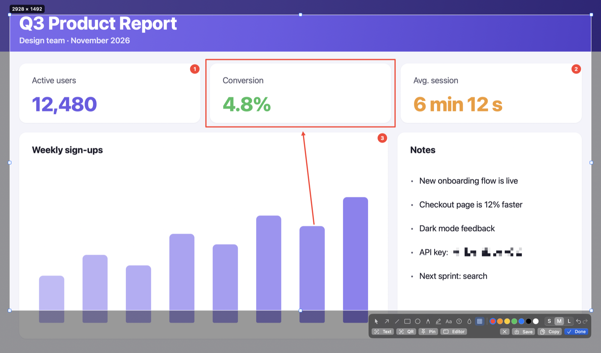
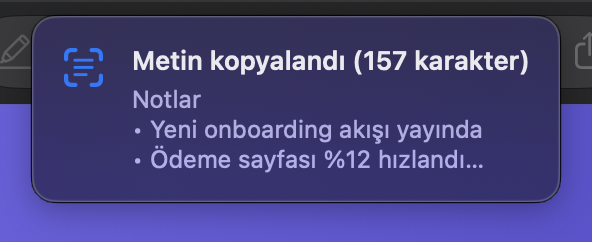
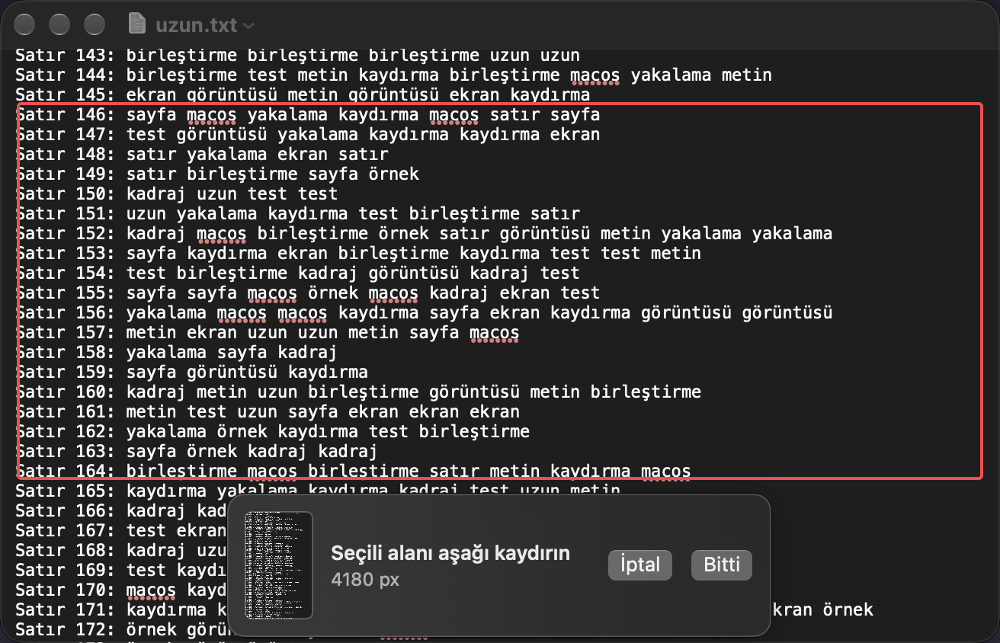

<p align="center">
  
</p>

<h1 align="center">Kadraj</h1>

<p align="center">
  <b>An open-source screenshot tool for macOS.</b><br>
  Select, draw on it, copy — all in one flow.
</p>

<p align="center">
  <a href="https://github.com/mahiruslu/kadraj/releases/latest"></a>
  
  
  <a href="LICENSE"></a>
</p>

<p align="center">
  <a href="README.tr.md">Türkçe</a>
</p>

<p align="center">
  
</p>

> Kadraj speaks English and Turkish and follows your Mac's language. To pick one just for Kadraj: *System Settings → General → Language & Region → Applications*.

## Install

One line, no admin password:

```bash
curl -fsSL https://raw.githubusercontent.com/mahiruslu/kadraj/main/install.sh | bash
```

Or with [Homebrew](https://brew.sh):

```bash
brew install --cask mahiruslu/kadraj/kadraj
```

<details>
<summary>A specific release or the development build</summary>

```bash
# A specific release (with or without the leading v)
curl -fsSL https://raw.githubusercontent.com/mahiruslu/kadraj/main/install.sh | bash -s -- 0.1.1

# Nightly build of main
curl -fsSL https://raw.githubusercontent.com/mahiruslu/kadraj/main/install.sh | bash -s -- main
```
</details>

macOS 14 Sonoma or later · Apple Silicon and Intel · signed and notarized by Apple, no Gatekeeper warning.

## What it does

- ✏️ **Annotate in place** — The moment you select an area, a toolbar opens under it: arrow, box, ellipse, pen, highlighter, text, numbered steps, blur, pixelate. Click a window without dragging to select it instead. The selection stays resizable while you annotate.
- 📜 **Scrolling capture** — Stitches long pages and chats into one image; sticky headers and footers don't repeat.
- 🔤 **OCR and QR** — Reads text in the selection offline (Turkish included) and decodes QR codes.
- 🎬 **Screen recording and GIF** — Records an area or the whole screen as MP4, optionally with system audio and your microphone, and converts it to GIF in one click.
- 📌 **Pin to screen** — Keeps an image floating above everything.
- 🎨 **Color picker and ruler** — Copies a pixel's color as HEX/RGB/HSL, measures on screen.
- 🔒 **Private** — Everything runs on your Mac. The only network request is a once-a-day update check against GitHub, which you can turn off.

<table>
  <tr>
    <td width="50%"></td>
    <td width="50%"></td>
  </tr>
  <tr>
    <td align="center"><sub>Text in the selection, on your clipboard</sub></td>
    <td align="center"><sub>Scroll, Kadraj stitches</sub></td>
  </tr>
</table>

## Usage

Kadraj lives in the menu bar (viewfinder icon). Every shortcut can be changed in **Settings**. Don't want the icon? Hide it with **Settings → General → "Show in menu bar"**; shortcuts keep working, and opening Kadraj again from Applications or Spotlight brings the settings back.

| Shortcut | Action |
|---|---|
| `⌥⇧A` | Select an area (or click a window) and annotate in place |
| `⌥⇧W` | Capture a window |
| `⌥⇧F` | Full screen |
| `⌥⇧S` | Scrolling capture (press `⌥⇧S` again or **Done** to finish) |
| `⌥⇧R` | Start / stop screen recording |
| `⌥⇧O` | Recognize text (OCR) |
| `⌥⇧Q` | Read a QR code |
| `⌥⇧C` | Pick a color |
| `⌥⇧M` | Ruler |

### After selecting

When you release the selection, a two-row toolbar opens under it:

- **Top row:** tools, colors, width (S/M/L), undo / redo
- **Bottom row:** **Text** (OCR), **QR**, **Pin**, **Editor**, **Save** (`⌘S`), **Copy** (`⌘C`), **Done** (`Return`)

Resize the selection with its corner and edge handles; with no annotation selected, arrow keys move it and `⌥`+arrows resize it. `Esc` cancels.

<details>
<summary>Tool shortcuts</summary>

| Key | Tool | Key | Tool |
|---|---|---|---|
| `V` | Select / move (`⌫` deletes) | `T` | Text |
| `A` | Arrow | `N` | Numbered step |
| `L` | Line | `B` | Blur |
| `R` | Rectangle | `M` | Pixelate |
| `O` | Ellipse | `C` | Crop (editor only) |
| `P` | Pen | `H` | Highlighter |

`⇧` snaps lines/arrows to 45° and rectangles/ellipses to squares. Changing color or width also restyles the selected annotation.
</details>

Prefer instant captures? **Settings → General → "Capture on mouse release"** saves/copies as soon as you release, with a **Quick Access** thumbnail in the bottom-right corner.

### Automation

From Raycast, Alfred or Shortcuts:

```bash
open "kadraj://capture/area"     # window, fullscreen, scroll, record, text, qr, color, ruler
open "kadraj://settings"
open "kadraj://check-updates"
```

## Permissions

Kadraj only needs **Screen Recording**. On first launch it guides you: enable Kadraj under *System Settings → Privacy & Security → Screen Recording*, then relaunch it. **Microphone** access is asked for only if you turn on **Settings → General → "Record microphone"** (macOS 15 or later).

macOS 15 and later occasionally show *"Kadraj is requesting to bypass the system private window picker…"* — a system prompt every screen-capturing tool gets; choose **Allow**.

If your organization blocks this permission via MDM, IT can let standard users grant it themselves with the profile in [docs/MDM.md](docs/MDM.md).

> Turkish OCR needs a macOS version whose Vision includes the Turkish model; older versions use the other languages.

## Updating and uninstalling

Menu → **Check for Updates…**: a new version is downloaded, its signature verified and Kadraj updated in place (no admin rights). The same message lets you switch between the stable release and the nightly build. Kadraj also checks once a day on its own and only speaks up when there is a new version (**Settings → General → "Check for updates automatically"**). Re-running the install command also updates. **Settings → General → "Launch at login"** starts Kadraj when you log in.

To uninstall:

```bash
curl -fsSL https://raw.githubusercontent.com/mahiruslu/kadraj/main/uninstall.sh | bash
```

## Development

Swift 6 and SwiftPM; there is no `.xcodeproj`. Open the code in Xcode with `xed .`, run it with `scripts/dev.sh` (builds, bundles a `.app`, signs and relaunches).

```bash
swift test                        # unit tests
scripts/dev.sh                    # fast dev loop (dist-dev/Kadraj.app)
scripts/bundle.sh                 # dist/Kadraj.app (universal)
/bin/bash Tests/install_test.sh   # installer tests
```

> If `swift build` fails with a manifest link error under Command Line Tools, use Xcode's toolchain: `export DEVELOPER_DIR=/Applications/Xcode.app/Contents/Developer`.

The UI is written in English; the Turkish translation lives in `Resources/tr.lproj/Localizable.strings`, and `swift test` fails if a string has no translation.

<details>
<summary>Releasing (maintainers)</summary>

Pushing a `v*` tag makes GitHub Actions build, sign and notarize the app and upload `Kadraj.zip` + `Kadraj.zip.sha256` to the release. Tags containing `-` (e.g. `v1.2.0-beta.1`) become prereleases. Every push to `main` updates the `nightly` prerelease.

Required repository secrets:

| Secret | Contents |
|---|---|
| `DEVELOPER_ID_P12` | "Developer ID Application" certificate + private key, `.p12`, `base64` |
| `DEVELOPER_ID_P12_PASSWORD` | `.p12` password |
| `DEVELOPER_ID_NAME` | `Developer ID Application: Full Name (TEAMID)` |
| `NOTARY_KEY_ID` | App Store Connect API key ID |
| `NOTARY_ISSUER_ID` | App Store Connect issuer ID |
| `NOTARY_KEY_P8` | `AuthKey_XXXX.p8` file, `base64` |

```bash
base64 -i DeveloperID.p12 | gh secret set DEVELOPER_ID_P12
gh secret set DEVELOPER_ID_P12_PASSWORD
gh secret set DEVELOPER_ID_NAME --body "Developer ID Application: Full Name (TEAMID)"
gh secret set NOTARY_KEY_ID --body "XXXXXXXXXX"
gh secret set NOTARY_ISSUER_ID --body "xxxxxxxx-xxxx-xxxx-xxxx-xxxxxxxxxxxx"
base64 -i AuthKey_XXXXXXXXXX.p8 | gh secret set NOTARY_KEY_P8
```
</details>

## License

[MIT](LICENSE) © 2026 Mahir Uslu
