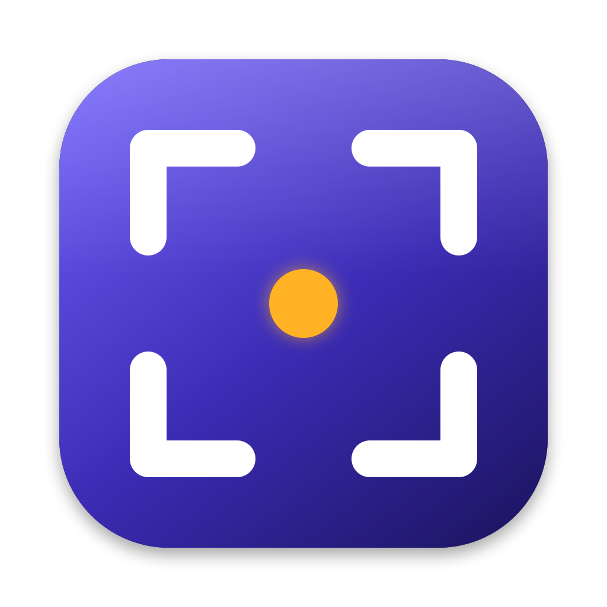
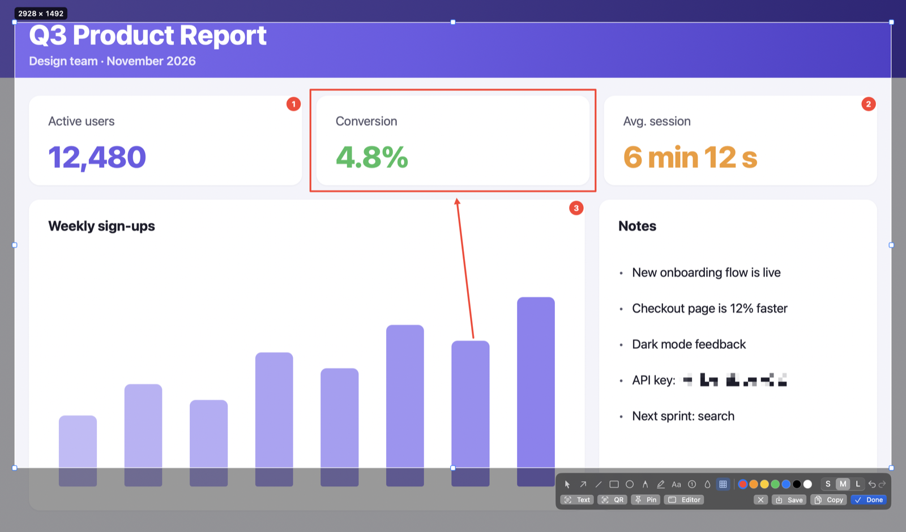
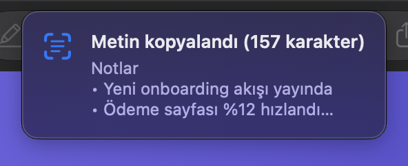
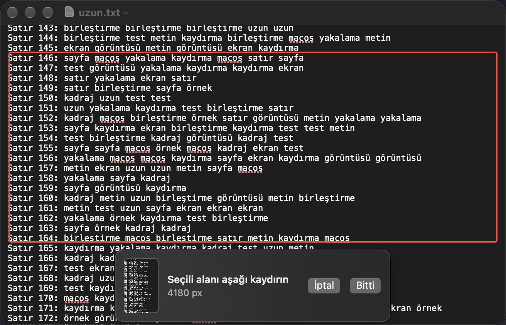

<p align="center">
  
</p>

<h1 align="center">Kadraj</h1>

<p align="center">
  <b>macOS için açık kaynak ekran görüntüsü aracı.</b><br>
  Seç, üstüne çiz, kopyala — hepsi tek akışta.
</p>

<p align="center">
  <a href="https://github.com/mahiruslu/kadraj/releases/latest"></a>
  
  
  <a href="LICENSE"></a>
</p>

<p align="center">
  <a href="README.md">English</a>
</p>

<p align="center">
  
</p>

> Kadraj Türkçe ve İngilizce konuşur, Mac'inin dilini izler. Sadece Kadraj için dil seçmek istersen: *Sistem Ayarları → Genel → Dil ve Bölge → Uygulamalar*.

## Kurulum

Tek satır, yönetici parolası istemez:

```bash
curl -fsSL https://raw.githubusercontent.com/mahiruslu/kadraj/main/install.sh | bash
```

<details>
<summary>Belirli bir sürüm ya da geliştirme sürümü</summary>

```bash
# Belirli bir sürüm (başında v olsa da olmasa da olur)
curl -fsSL https://raw.githubusercontent.com/mahiruslu/kadraj/main/install.sh | bash -s -- 0.1.1

# main dalından derlenen nightly
curl -fsSL https://raw.githubusercontent.com/mahiruslu/kadraj/main/install.sh | bash -s -- main
```
</details>

macOS 14 Sonoma veya üstü · Apple Silicon ve Intel · Apple tarafından imzalanıp notarize edilmiş, Gatekeeper uyarısı yok.

## Neler yapıyor?

- ✏️ **Yerinde düzenleme** — Alanı seçtiğin anda altında araç çubuğu açılır: ok, kutu, elips, kalem, vurgulayıcı, metin, numaralı adım, bulanıklaştırma, mozaik. Sürüklemeden bir pencereye tıklarsan o pencere seçilir. Seçim düzenlerken de boyutlandırılabilir.
- 📜 **Kaydırarak yakalama** — Uzun sayfaları, sohbetleri tek görüntüde birleştirir; sabit başlık ve altbilgiler tekrar etmez.
- 🔤 **OCR ve QR** — Seçili alandaki metni (Türkçe dahil) internetsiz okur, QR kodları çözer.
- 🎬 **Ekran kaydı ve GIF** — Alanı veya ekranın tamamını MP4 olarak kaydeder; istersen sistem sesini ve mikrofonunu da ekler, tek tıkla GIF'e çevirir.
- 📌 **Ekrana pinleme** — Görüntüyü her zaman üstte duran küçük bir pencere olarak sabitler.
- 🎨 **Renk seçici ve cetvel** — Bir pikselin rengini HEX/RGB/HSL kopyalar, ekranda boyut ölçer.
- 🔒 **Gizlilik** — Her şey bu Mac'te çalışır. Tek ağ isteği günde bir kez GitHub'dan güncelleme kontrolüdür ve kapatılabilir.

<table>
  <tr>
    <td width="50%"></td>
    <td width="50%"></td>
  </tr>
  <tr>
    <td align="center"><sub>Seçili alandaki metin panoya</sub></td>
    <td align="center"><sub>Kaydır, Kadraj birleştirsin</sub></td>
  </tr>
</table>

## Kullanım

Kadraj menü çubuğunda vizör simgesiyle çalışır. Tüm kısayollar **Ayarlar**'dan değiştirilebilir. Simgeyi istemiyorsan **Ayarlar → Genel → "Menü çubuğunda göster"** ile gizleyebilirsin; kısayollar çalışmaya devam eder, Ayarlar'a dönmek için Kadraj'ı Uygulamalar'dan veya Spotlight'tan tekrar açman yeterli.

| Kısayol | İşlem |
|---|---|
| `⌥⇧A` | Alan seç (ya da pencereye tıkla) ve yerinde düzenle |
| `⌥⇧W` | Pencere yakala |
| `⌥⇧F` | Tam ekran |
| `⌥⇧S` | Kaydırarak yakala (bitirmek için tekrar `⌥⇧S` ya da **Bitti**) |
| `⌥⇧R` | Ekran kaydını başlat / durdur |
| `⌥⇧O` | Metin tanı (OCR) |
| `⌥⇧Q` | QR kod oku |
| `⌥⇧C` | Renk seç |
| `⌥⇧M` | Cetvel |

### Seçimden sonra

Seçimi bıraktığında altında iki satırlık bir araç çubuğu açılır:

- **Üst satır:** araçlar, renkler, kalınlık (S/M/L), geri al / yinele
- **Alt satır:** **Metin** (OCR), **QR**, **Pinle**, **Editör**, **Kaydet** (`⌘S`), **Kopyala** (`⌘C`), **Bitti** (`Return`)

Köşe ve kenar tutamaklarıyla seçimi büyütüp küçültebilirsin; bir işaretleme seçili değilken ok tuşları seçimi taşır, `⌥`+ok boyutlandırır. `Esc` iptal eder.

<details>
<summary>Araç kısayolları</summary>

| Tuş | Araç | Tuş | Araç |
|---|---|---|---|
| `V` | Seç / taşı (`⌫` siler) | `T` | Metin |
| `A` | Ok | `N` | Numaralı adım |
| `L` | Çizgi | `B` | Bulanıklaştır |
| `R` | Dikdörtgen | `M` | Mozaik |
| `O` | Elips | `C` | Kırp (yalnız editörde) |
| `P` | Kalem | `H` | Vurgulayıcı |

`⇧` ile çizgi/ok 45°'ye, dikdörtgen/elips kareye kilitlenir. Renk veya kalınlık değiştirmek seçili işaretlemeyi de değiştirir.
</details>

Hızlı yakalama mı istiyorsun? **Ayarlar → Genel → "Fareyi bırakınca hemen yakala"** ile seçim bırakıldığı an kaydedilir/kopyalanır ve sağ altta **Quick Access** küçük resmi çıkar.

### Otomasyon

Raycast, Alfred veya Kestirmeler'den:

```bash
open "kadraj://capture/area"     # window, fullscreen, scroll, record, text, qr, color, ruler
open "kadraj://settings"
open "kadraj://check-updates"
```

## İzinler

Kadraj'ın istediği tek izin **Ekran Kaydı**dır. İlk açılışta seni yönlendirir: *Sistem Ayarları → Gizlilik ve Güvenlik → Ekran Kaydı* altında Kadraj'ı aç, sonra Kadraj'ı yeniden başlat. **Mikrofon** izni sadece **Ayarlar → Genel → "Mikrofonu kaydet"** açılırsa istenir (macOS 15 veya üstü).

macOS 15 ve sonrası zaman zaman *"Kadraj is requesting to bypass the system private window picker…"* diye sorar; bu, ekranı yakalayan tüm araçlarda görülen bir sistem onayıdır, **Allow** ile devam edebilirsin.

Şirket bilgisayarında bu izin MDM ile kapalıysa IT ekibin [docs/MDM.md](docs/MDM.md)'deki profille standart kullanıcıların izni kendilerinin vermesine olanak tanıyabilir.

> Türkçe OCR, Vision'ın Türkçe modelini içeren yeni macOS sürümlerinde çalışır; eski sürümlerde diğer diller kullanılır.

## Güncelleme ve kaldırma

Menüden **Güncellemeleri Kontrol Et…** — yeni sürüm varsa indirilir, imzası doğrulanır ve Kadraj yerinde güncellenir (yönetici izni gerekmez). Aynı mesajdan kararlı sürüm ile nightly arasında geçiş de yapabilirsin. Kadraj ayrıca günde bir kez kendisi bakar ve sadece yeni sürüm varsa haber verir (**Ayarlar → Genel → "Güncellemeleri otomatik kontrol et"**). Kurulum komutunu tekrar çalıştırmak da günceller. **Ayarlar → Girişte başlat** ile oturum açınca otomatik açılır.

Kaldırmak için:

```bash
curl -fsSL https://raw.githubusercontent.com/mahiruslu/kadraj/main/uninstall.sh | bash
```

## Geliştirme

Swift 6 ve SwiftPM; `.xcodeproj` yok. Kodu Xcode'da açmak için `xed .`, çalıştırmak için `scripts/dev.sh` (derler, `.app` olarak paketler, imzalar ve yeniden başlatır).

```bash
swift test                        # birim testleri
scripts/dev.sh                    # hızlı geliştirme döngüsü (dist-dev/Kadraj.app)
scripts/bundle.sh                 # dist/Kadraj.app (universal)
/bin/bash Tests/install_test.sh   # kurulum scripti testleri
```

> Command Line Tools ile `swift build` manifest hatası verirse Xcode'un araç zincirini kullan: `export DEVELOPER_DIR=/Applications/Xcode.app/Contents/Developer`.

<details>
<summary>Sürüm yayınlama (bakımcılar için)</summary>

`v*` etiketi push edildiğinde GitHub Actions uygulamayı derler, imzalar, notarize eder ve `Kadraj.zip` + `Kadraj.zip.sha256` dosyalarını release'e yükler. `-` içeren etiketler (ör. `v1.2.0-beta.1`) ön sürüm olarak yayınlanır. `main`'e her push `nightly` ön sürümünü günceller.

Gerekli repository secret'ları:

| Secret | İçerik |
|---|---|
| `DEVELOPER_ID_P12` | "Developer ID Application" sertifikası + özel anahtarı, `.p12`, `base64` |
| `DEVELOPER_ID_P12_PASSWORD` | `.p12` parolası |
| `DEVELOPER_ID_NAME` | `Developer ID Application: Ad Soyad (TEAMID)` |
| `NOTARY_KEY_ID` | App Store Connect API anahtar ID'si |
| `NOTARY_ISSUER_ID` | App Store Connect issuer ID |
| `NOTARY_KEY_P8` | `AuthKey_XXXX.p8` dosyası, `base64` |

```bash
base64 -i DeveloperID.p12 | gh secret set DEVELOPER_ID_P12
gh secret set DEVELOPER_ID_P12_PASSWORD
gh secret set DEVELOPER_ID_NAME --body "Developer ID Application: Ad Soyad (TEAMID)"
gh secret set NOTARY_KEY_ID --body "XXXXXXXXXX"
gh secret set NOTARY_ISSUER_ID --body "xxxxxxxx-xxxx-xxxx-xxxx-xxxxxxxxxxxx"
base64 -i AuthKey_XXXXXXXXXX.p8 | gh secret set NOTARY_KEY_P8
```
</details>

## Lisans

[MIT](LICENSE) © 2026 Mahir Uslu
